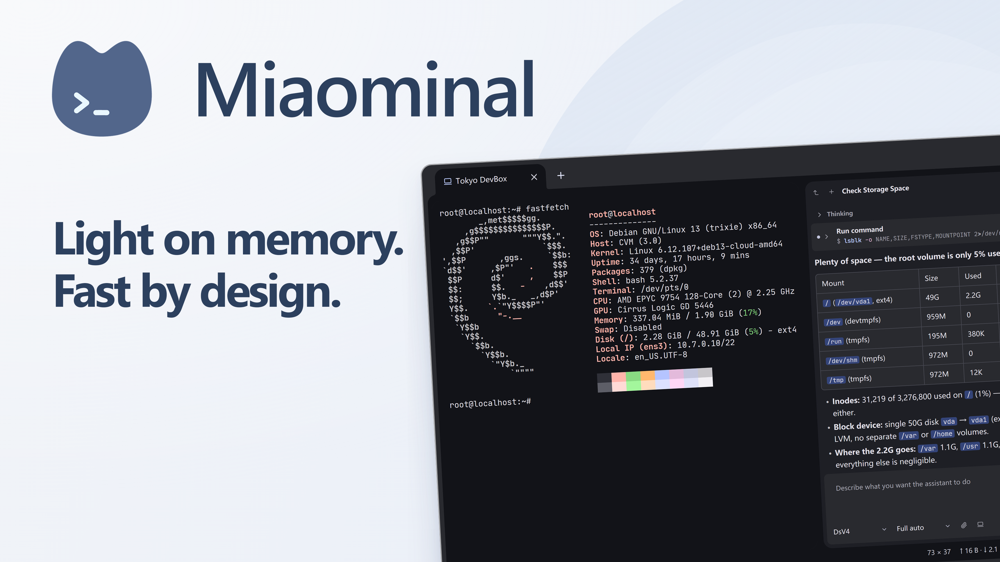
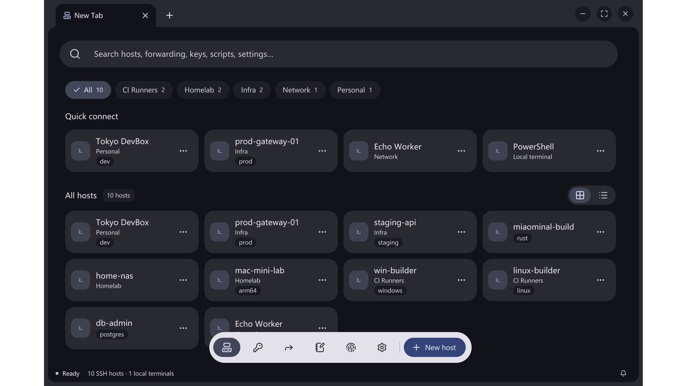
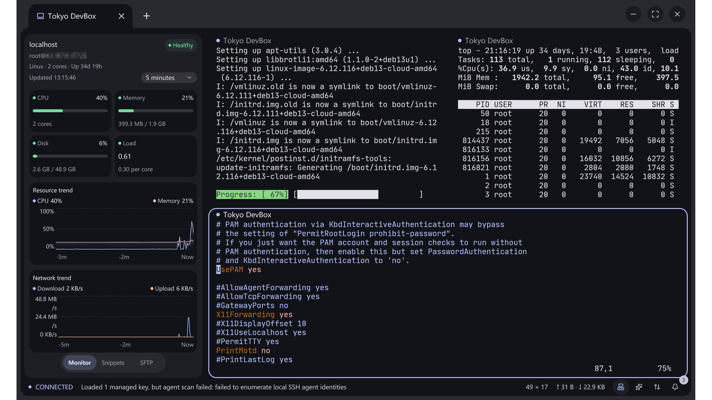
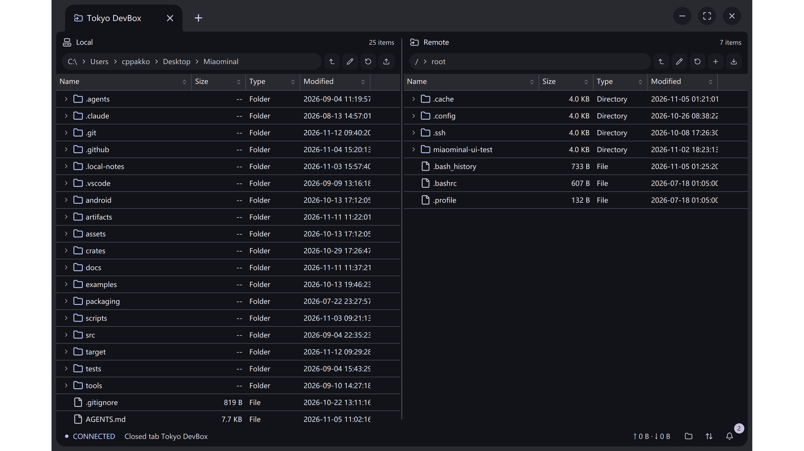
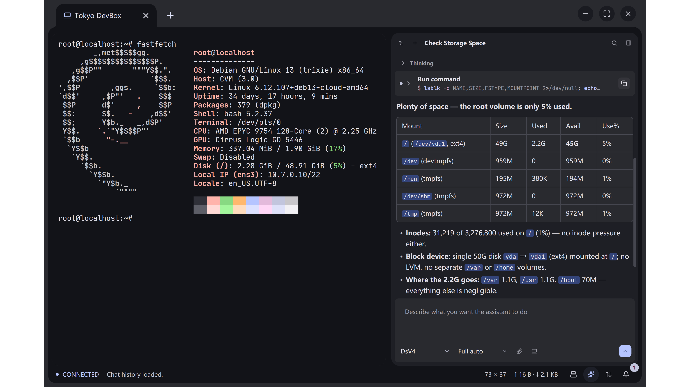

<div align="center" style="border-bottom: none">
    <p>
        
    </p>
    <a href="https://github.com/cppakko/miaominal/releases"></a>
    <a href="https://github.com/cppakko/miaominal/actions/workflows/release.yml"></a>
    <a href="https://www.rust-lang.org/"></a>
    <a href="../LICENSE"></a>
    <br>
    <p align="center">
        A desktop workspace for remote development and server operations, bringing terminals, file transfers, and a session AI assistant together.
        <br>
        Built with Rust, GPUI Kit, and <code>alacritty_terminal</code>.
    </p>
</div>

<p align="center"><a href="./README.md">English</a> · <a href="./README_zh.md">简体中文</a></p>

<p align="center"><a href="https://github.com/cppakko/miaominal/releases/latest">Download</a> · <a href="#features">Features</a> · <a href="#installation">Installation</a> · <a href="#core-workflows">Core Workflows</a> · <a href="#credentials-and-sync">Credentials and Sync</a> · <a href="#building-from-source">Building from Source</a></p>

## Features

- **Terminal workspace:** SSH, Telnet, and local terminals with tabs, split panes, search, detached windows, and Free Type mode.
- **Host management:** Groups, tags, unified search, and snippets, with SOCKS5 / HTTP CONNECT proxies and SSH profile imports from OpenSSH, PuTTY, SecureCRT, and FinalShell.
- **SFTP file transfer:** Browse local and remote files side by side, upload and download, save path favorites, and pause, resume, or cancel transfers.
- **Session Agent:** Ask questions using terminal context, read files, run commands, and edit files under the selected approval mode, with attachments and background tasks.
- **Forwarding and monitoring:** Manage local and remote port forwarding, and view CPU, memory, disk, network, and load metrics for SSH hosts.
- **Remote desktop:** Launch external RDP clients directly or through SSH tunnels.
- **OpenSSH integration:** Use saved SSH hosts from external clients through exported configuration or Bridge connections.
- **Configuration sync:** Sync manually or automatically through GitHub Gist or WebDAV, with sensitive fields encrypted before upload.

<p align="center">
    
</p>

## Installation

Download the package for your operating system and processor architecture from [Releases](https://github.com/cppakko/miaominal/releases/latest).

| Platform | Package | Installation |
| --- | --- | --- |
| macOS arm64 | `.dmg` | Open the image and drag Miaominal into Applications |
| Windows x64 / arm64 | `*-setup.exe` | Run the installer, or download `*-standalone.exe` to run without installation |
| Linux x86_64 / arm64 | `.AppImage`, `.deb`, `.rpm` | Make the AppImage executable, or install with your package manager |
| All three platforms | `*-portable.zip` | Extract and run, keeping application data in the included `data` directory |

> [!WARNING]
> Miaominal is not notarized for macOS. If the system blocks the app, remove the quarantine attribute:
> ~~~bash
> xattr -dr com.apple.quarantine /Applications/Miaominal.app
> ~~~

Linux AppImage example (replace the filename with the one you downloaded):

```bash
chmod +x Miaominal-0.3.1-x86_64.AppImage
./Miaominal-0.3.1-x86_64.AppImage
```

The Windows Standalone version uses the standard data directory by default. Choose the Portable package to carry your data with the program; see [portable mode](#data-directories-and-portable-mode) below.

## Core Workflows

### Hosts and Terminal Sessions

Save SSH, Telnet, and local terminal profiles, and organize daily connections with groups, tags, and recent connections. Unified search finds hosts, forwarding rules, keys, snippets, and settings directly.

Open multiple terminal tabs, split panes, or move tabs into detached windows. Free Type mode lets you click to move the cursor, select editable text, and drag it. Interface and terminal fonts and sizes can be configured independently.

System tray support, configurable close behavior, and single-instance activation help manage the desktop workspace. The notification center keeps operation history and provides shortcuts for items such as sync conflicts.

<p align="center">
    
</p>

Telnet supports direct connections and entry proxies, but SSH-only features such as SFTP, SSH monitoring, and port forwarding are unavailable. Agent command execution is disabled by default for each Telnet host and must be enabled separately in its editor.

> [!WARNING]
> Telnet does not encrypt terminal traffic or login credentials. Use it only on trusted networks; prefer SSH when available.

### SFTP File Transfer

Open an SFTP tab for the local / remote dual-pane browser, or browse remote files from an SSH terminal's side panel. Upload and download files, create directories, save path favorites, and confirm overwrites or deletes.

Pause, resume, or cancel tasks in the transfer progress center. Favorite remote paths can be synced with your configuration.

<p align="center">
    
</p>

### Session Agent

Open an Agent panel next to the current session and configure an OpenAI-compatible Chat Completions or Anthropic Messages provider. Ask questions using selected text, terminal context, and attachments.

Mention opened or saved SSH hosts with `@` to read and search files, run commands, and apply patches on a specific target. POSIX targets also support background tasks. Configure web lookup to use Web Search / Fetch.

Click the insert button on a single-line code block in a reply to place the command in the active terminal. Insertion does not press Enter or execute the command.

| Approval mode | Behavior |
| --- | --- |
| **Read-only** | Allows read-only tools and shell commands assessed as read-only; denies file edits and other operations with side effects. |
| **Standard** | Read-only operations and low-risk changes can run automatically; service-impacting or dangerous actions require approval. |
| **Cautious** | Read-only operations can run directly; other operations request approval. |
| **Full auto** | Read-only, low-risk, and service-impacting actions can run automatically. Dangerous actions still require approval unless the separate destructive-action setting is enabled. |

Forbidden commands and protected sensitive paths remain blocked in every mode. Approval modes provide risk checks, not an operating-system sandbox.

Conversation event payloads are encrypted locally; metadata such as titles and timestamps is not. Recovery cancels unfinished tool calls without automatically re-executing them.

<p align="center">
    
</p>

### Port Forwarding and Monitoring

Create local or remote forwarding rules for saved SSH hosts, then quickly connect, disconnect, copy, edit, or open the forwarded target in a browser. Once an SSH session is ready, the monitoring panel shows CPU, memory, Swap, disk, network, and load metrics.

### Remote Desktop (RDP)

Choose **Remote desktop…** from an SSH host's context menu to launch an external client directly or through an SSH tunnel. Supported clients include `mstsc` on Windows, Windows App / Microsoft Remote Desktop on macOS, and Remmina / SDL3 FreeRDP on Linux.

SSH tunnels reuse the host's proxies and jump route to reach the RDP service on the final SSH host. Keep Miaominal running while using a tunnel. Manage clients and tunnels in the footer **Status** center.

### OpenSSH Integration

Choose a mode under **Settings → OpenSSH Integration** to use saved SSH hosts from external OpenSSH clients:

| Mode | Connection behavior |
| --- | --- |
| Direct | Exports ordinary OpenSSH configuration for the external client to connect. Cannot directly use passwords saved in Miaominal or Miaominal-specific routes. |
| Bridge | Miaominal establishes the connection using saved credentials and entry proxies. The app must stay running, and credentials must be available. |

The settings page shows the generated configuration file path. Find a `Host` alias in the file to connect from an external terminal. For example, if it contains `Host miaominal-production`:

```bash
ssh miaominal-production
```

Bridge does not export passwords or private keys into the generated configuration. It supports connection approval, system authentication on supported platforms, and audit logs.

## Credentials and Sync

Local credential storage and cloud sync are managed separately:

- **Local storage:** API keys, SSH passwords, sync credentials, and managed private keys use the system credential store by default and can be migrated to an encrypted local vault.
- **Sensitive field encryption:** Passwords, private keys, and API keys included in sync are encrypted with an Argon2id-derived key and AES-256-GCM. Ordinary configuration is not encrypted. GitHub tokens and WebDAV passwords stay in the local credential store.
- **Sync scope:** Includes SSH hosts, proxies, snippets, managed keys, remote path favorites, shortcuts, model providers, and other configuration. Device-local options such as interface appearance are excluded.
- **Automatic sync:** Disabled by default. When enabled, it pushes local changes and checks for remote updates. Conflicts stop automatic operations and prompt manual handling; sync pauses while the vault is locked.

The local vault password and sync passphrase are independent. After pulling configuration on a new device, enter the same sync passphrase to decrypt synced sensitive fields.

## Data Directories and Portable Mode

In standard mode, select a custom data directory in settings and migrate your existing data.

For Portable packages, keep the program, `portable.flag`, and `data` directory together when moving them. On macOS, the flag and data directory sit beside the `.app` bundle. You can also enable portable mode with the `--portable` startup argument.

Portable mode stores sensitive credentials in a local vault. After moving to another device, use the original vault password to unlock them.

## Building from Source

Install the Rust toolchain and obtain the repository source first, then run the following commands from the repository root.

### macOS Example

```bash
brew install cmake
xcodebuild -downloadComponent MetalToolchain
cargo build --release
```

### Linux Example

Ubuntu 24.04 example:

```bash
sudo apt-get update
sudo apt-get install -y \
  build-essential clang cmake curl git pkg-config \
  libasound2-dev libdbus-1-dev libfontconfig-dev libglib2.0-dev \
  libgtk-3-dev libayatana-appindicator3-dev \
  libgit2-dev libsecret-1-dev libsqlite3-dev libssl-dev libva-dev \
  libvulkan1 libwayland-dev libx11-xcb-dev libxkbcommon-x11-dev \
  libzstd-dev
cargo build --release
```

### Windows Example

```powershell
winget install -e --id Kitware.CMake
choco install nasm --yes --no-progress
cargo build --release
```

## License

Copyright (c) 2026 akko.

Miaominal is licensed under [GNU GPL-3.0-only](../LICENSE).
