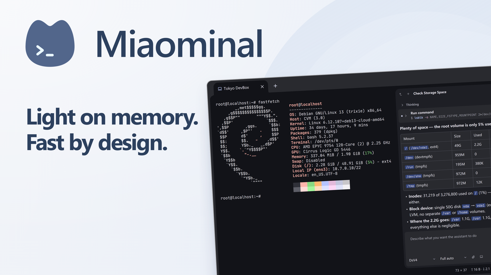
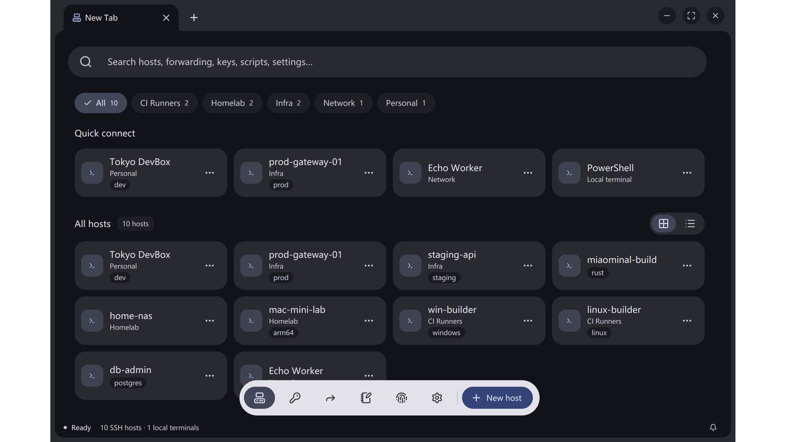
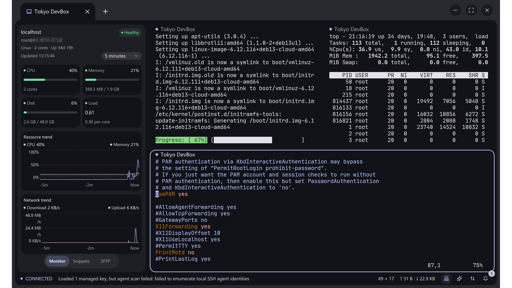
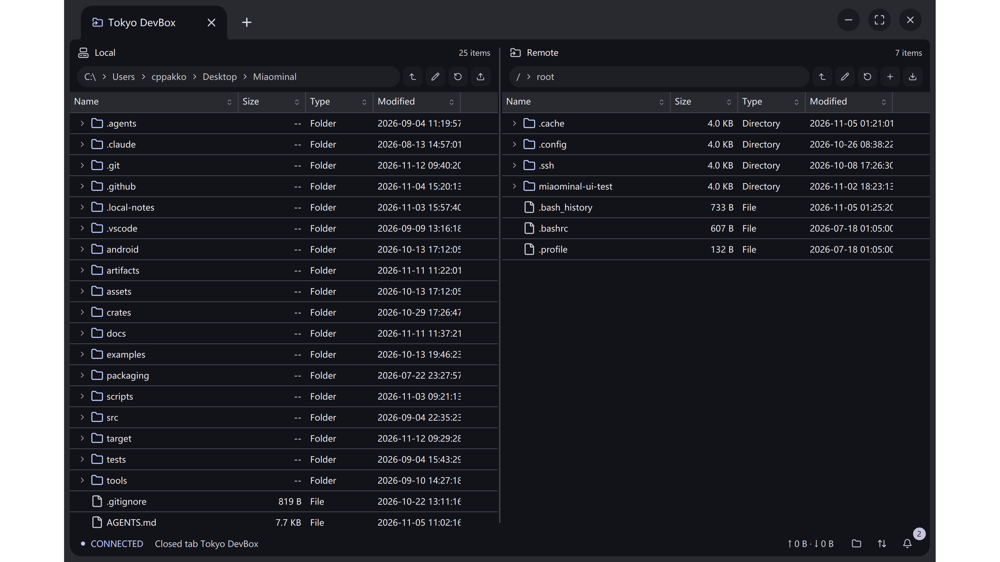
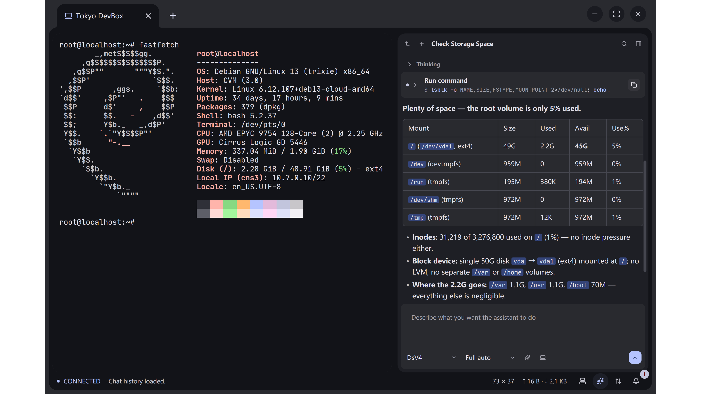

<div align="center" style="border-bottom: none">
    <p>
        
    </p>
    <a href="https://github.com/cppakko/miaominal/releases"></a>
    <a href="https://github.com/cppakko/miaominal/actions/workflows/release.yml"></a>
    <a href="https://www.rust-lang.org/"></a>
    <a href="../LICENSE"></a>
    <br>
    <p align="center">
        面向远程开发与服务器运维的桌面工作台，将终端、文件传输和会话级 AI 助手集中在同一工作区。
        <br>
        使用 Rust、GPUI Kit 和 <code>alacritty_terminal</code> 构建。
    </p>
</div>

<p align="center"><a href="./README.md">English</a> · <a href="./README_zh.md">简体中文</a></p>

<p align="center"><a href="https://github.com/cppakko/miaominal/releases/latest">下载</a> · <a href="#功能">功能</a> · <a href="#安装">安装</a> · <a href="#核心工作流">核心工作流</a> · <a href="#凭据与同步">凭据与同步</a> · <a href="#从源码构建">从源码构建</a></p>

## 功能

- **终端工作区**：SSH、Telnet 与本地终端，支持标签页、分屏、搜索、独立窗口和自由输入模式。
- **主机管理**：分组、标签、统一搜索与命令片段，支持 SOCKS5 / HTTP CONNECT 代理，以及从 OpenSSH、PuTTY、SecureCRT 和 FinalShell 导入 SSH 配置。
- **SFTP 文件传输**：本地 / 远程双栏浏览、上传下载、路径收藏，以及传输任务的暂停、恢复与取消。
- **Session Agent**：结合终端上下文问答，按审批模式读取文件、执行命令和编辑文件，支持附件与后台任务。
- **转发与监控**：管理本地 / 远程端口转发，查看 SSH 主机的 CPU、内存、磁盘、网络和负载指标。
- **远程桌面**：直接或通过 SSH 隧道启动外部 RDP 客户端。
- **OpenSSH 集成**：让外部客户端使用已保存的 SSH 主机，支持配置导出与 Bridge 连接。
- **配置同步**：通过 GitHub Gist 或 WebDAV 手动或自动同步配置，参与同步的敏感字段在上传前加密。

<p align="center">
    
</p>

## 安装

从 [Releases](https://github.com/cppakko/miaominal/releases/latest) 下载对应系统和处理器架构的发行包。

| 平台 | 发行包 | 安装方式 |
| --- | --- | --- |
| macOS arm64 | `.dmg` | 打开后将 Miaominal 拖入 Applications |
| Windows x64 / arm64 | `*-setup.exe` | 运行安装包；也可下载 `*-standalone.exe` 免安装运行 |
| Linux x86_64 / arm64 | `.AppImage`、`.deb`、`.rpm` | AppImage 授予执行权限后运行，或使用包管理器安装 |
| 三个平台 | `*-portable.zip` | 解压运行，数据随程序保存在包内 `data` 目录 |

> [!WARNING]
> Miaominal 未经过 macOS 公证签名。如果系统阻止启动，请移除隔离属性：
> ~~~bash
> xattr -dr com.apple.quarantine /Applications/Miaominal.app
> ~~~

Linux AppImage 示例（请替换为实际下载的文件名）：

```bash
chmod +x Miaominal-0.3.1-x86_64.AppImage
./Miaominal-0.3.1-x86_64.AppImage
```

Windows 的 Standalone 版默认使用常规数据目录。需要随程序携带数据时，请选择 Portable 版，详见下方[便携模式](#数据目录与便携模式)。

## 核心工作流

### 主机与终端会话

保存 SSH、Telnet 和本地终端配置，通过分组、标签与最近连接管理日常目标。统一搜索可直接查找主机、转发规则、密钥、命令片段和设置。

在工作区中打开多个终端标签页、拆分窗格，或把标签页移入独立窗口。自由输入模式支持点击移动光标、选择和拖动可编辑文本；界面与终端的字体、字号可分别设置。

支持系统托盘、可配置的窗口关闭行为与单实例唤醒，通知中心保留操作历史，并为同步冲突等事项提供处理入口。

<p align="center">
    
</p>

Telnet 支持直连和入口代理，但不提供 SFTP、SSH 监控、端口转发等 SSH 专用能力。每个 Telnet 主机默认禁止 Agent 执行命令，需在主机编辑器中单独开启。

> [!WARNING]
> Telnet 不加密终端流量和登录凭据，请仅在可信网络中使用；条件允许时优先选择 SSH。

### SFTP 文件传输

打开 SFTP 标签页使用本地 / 远程双栏浏览器，也可从 SSH 终端的侧边面板浏览远程文件。支持上传下载、创建目录、路径收藏，以及覆盖和删除确认。

在传输进度中心暂停、恢复或取消任务，收藏的远程路径可随配置同步。

<p align="center">
    
</p>

### Session Agent

在当前会话旁打开 Agent 面板，配置 OpenAI 兼容 Chat Completions 或 Anthropic Messages 模型服务，即可结合选中文本、终端上下文与附件进行问答。

通过 `@` 提及已打开或已保存的 SSH 主机，让 Agent 在指定目标上读取和搜索文件、执行命令、应用补丁。POSIX 目标还支持后台任务；配置联网检索后可使用 Web Search / Fetch。

点击回复中单行代码块的插入按钮，可把命令放入活动终端；插入不会自动按 Enter，也不会执行命令。

| 审批模式 | 行为 |
| --- | --- |
| **只读** | 允许只读工具和被判定为只读的 shell 命令，拒绝文件编辑及其他有副作用的操作。 |
| **标准** | 只读操作和低风险修改可自动执行；影响服务或危险的操作需要批准。 |
| **谨慎** | 只读操作可直接运行，其他操作请求批准。 |
| **全自动** | 只读、低风险和影响服务的操作可自动执行；危险操作仍需批准，除非另行开启自动执行破坏性操作的设置。 |

所有模式都会拒绝禁止命令和受保护的敏感路径。审批模式提供风险检查，不是操作系统级沙箱。

会话事件载荷在本地加密保存，标题、时间戳等元数据不加密。中断恢复会取消未完成的工具调用，不会自动重新执行。

<p align="center">
    
</p>

### 端口转发与监控

为已保存的 SSH 主机创建本地或远程转发规则，快速连接、断开、复制、编辑，或在浏览器中打开转发目标。SSH 会话就绪后，监控面板可查看 CPU、内存、Swap、磁盘、网络和负载指标。

### 远程桌面（RDP）

从 SSH 主机的右键菜单选择“远程桌面…”，直接或通过 SSH 隧道启动外部客户端。支持 Windows 的 `mstsc`、macOS 的 Windows App / Microsoft Remote Desktop，以及 Linux 的 Remmina / SDL3 FreeRDP。

SSH 隧道复用主机的代理和跳板路由，连接最终 SSH 主机上的 RDP 服务；使用隧道期间需保持 Miaominal 运行。可在底部“状态”中心管理客户端与隧道。

### OpenSSH 集成

在“设置 → OpenSSH 集成”中选择模式，让外部 OpenSSH 客户端使用已保存的 SSH 主机：

| 模式 | 连接方式 |
| --- | --- |
| Direct | 导出普通 OpenSSH 配置，由外部客户端连接远端；无法直接使用 Miaominal 保存的密码和专用路由。 |
| Bridge | 由 Miaominal 建立连接，使用已保存凭据和入口代理；应用需保持运行，凭据需可用。 |

设置页会显示生成的配置文件路径。找到文件中的 `Host` 别名后，即可从外部终端连接。例如，配置中出现 `Host miaominal-production` 时：

```bash
ssh miaominal-production
```

Bridge 不会把密码或私钥导出到生成的配置，支持连接审批、受支持平台上的系统认证和审计日志。

## 凭据与同步

本地凭据存储与云端同步分别管理：

- **本地存储**：API 密钥、SSH 密码、同步凭据和托管私钥默认保存在系统凭据存储中，也可迁移到本地加密保险库。
- **敏感字段加密**：参与同步的密码、私钥和 API 密钥使用 Argon2id 派生密钥与 AES-256-GCM 加密；普通配置不加密。GitHub token 和 WebDAV 密码仅保存在本地凭据存储中。
- **同步范围**：包括 SSH 主机、代理、命令片段、托管密钥、远程路径收藏、快捷键及模型服务等配置；界面外观等设备本地选项不参与同步。
- **自动同步**：默认关闭。开启后自动推送本地变更并检查远端更新；遇到冲突时停止自动操作并提示处理，保险库锁定期间暂停同步。

本地保险库口令与同步口令相互独立。新设备拉取配置后，需输入相同同步口令才能解密同步过来的敏感字段。

## 数据目录与便携模式

常规模式下，可在设置中选择自定义数据目录并迁移现有数据。

使用 Portable 发行包时，保持程序、`portable.flag` 和 `data` 目录一起移动；macOS 的标记文件和数据目录位于 `.app` 包旁。也可通过 `--portable` 启动参数启用便携模式。

便携模式使用本地保险库保存敏感凭据。迁移到另一台设备后，仍需原保险库口令解锁。

## 从源码构建

先安装 Rust 工具链并获取仓库源码，然后在仓库根目录执行以下命令。

### macOS 示例

```bash
brew install cmake
xcodebuild -downloadComponent MetalToolchain
cargo build --release
```

### Linux 示例

Ubuntu 24.04 示例：

```bash
sudo apt-get update
sudo apt-get install -y \
  build-essential clang cmake curl git pkg-config \
  libasound2-dev libdbus-1-dev libfontconfig-dev libglib2.0-dev \
  libgtk-3-dev libayatana-appindicator3-dev \
  libgit2-dev libsecret-1-dev libsqlite3-dev libssl-dev libva-dev \
  libvulkan1 libwayland-dev libx11-xcb-dev libxkbcommon-x11-dev \
  libzstd-dev
cargo build --release
```

### Windows 示例

```powershell
winget install -e --id Kitware.CMake
choco install nasm --yes --no-progress
cargo build --release
```

## 许可证

Copyright (c) 2026 akko.

Miaominal 采用 [GNU GPL-3.0-only](../LICENSE) 许可证。
